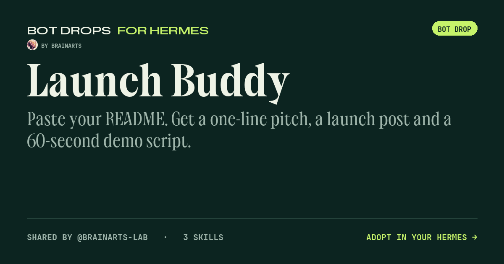

# Launch Buddy

Paste your README. Get a one-line pitch, a launch post and a 60-second demo script.

**[Open the bot page](https://brainarts-lab.github.io/launch-buddy/)** to adopt it with one click.

## What is inside

- A personality (`SOUL.md`)
- 3 skills: demo-script, launch-post, one-line-pitch
- Bring your own model access in Hermes
- No keys, memory or chats are included

## Make it yours

1. Install [Bot Drops](https://github.com/brainarts-lab/bot-drops) in Hermes: `hermes plugins install https://github.com/brainarts-lab/bot-drops --enable`
2. Open Bot Drops, paste the link of this repository and look at the preview.
3. Adopt it as a new bot. Your existing bots stay as they are.

In a Hermes chat you can also send the link and ask to preview the bot.

Profiles are not a security sandbox. Only adopt bots from people you trust.
